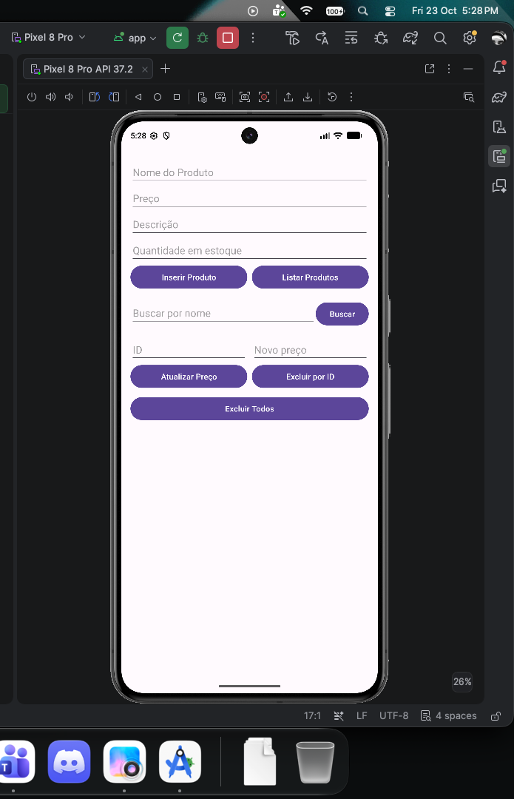
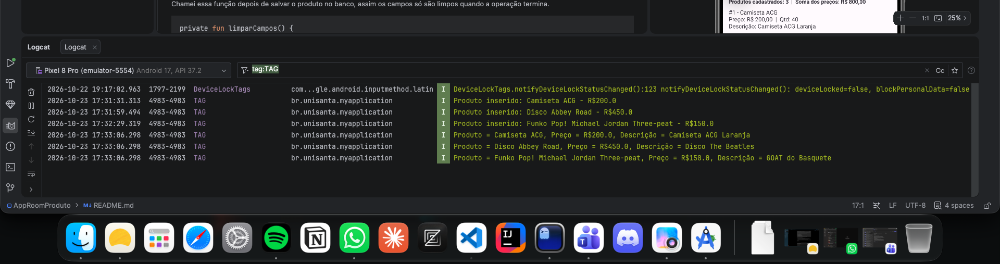
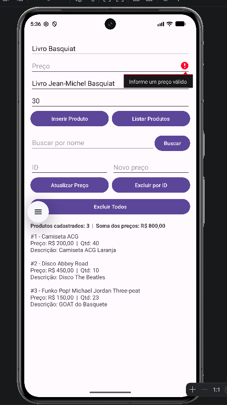
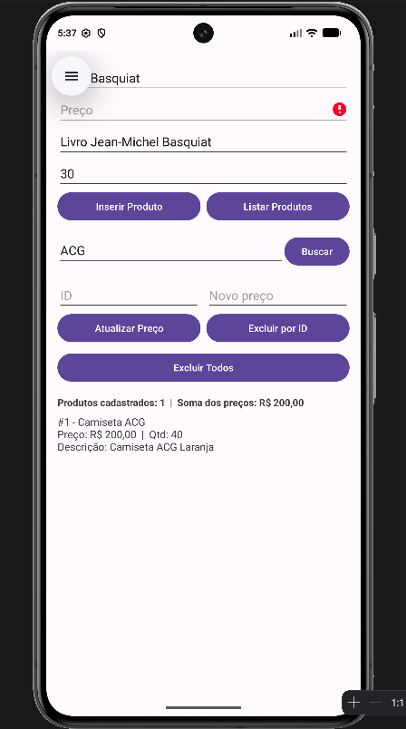
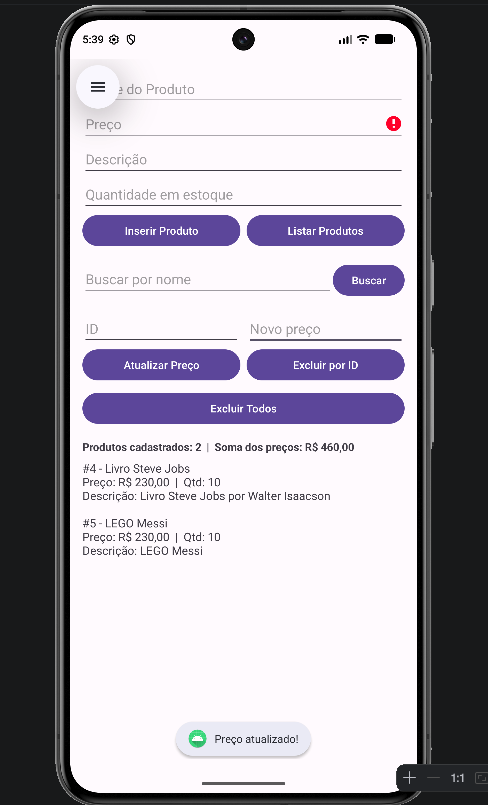
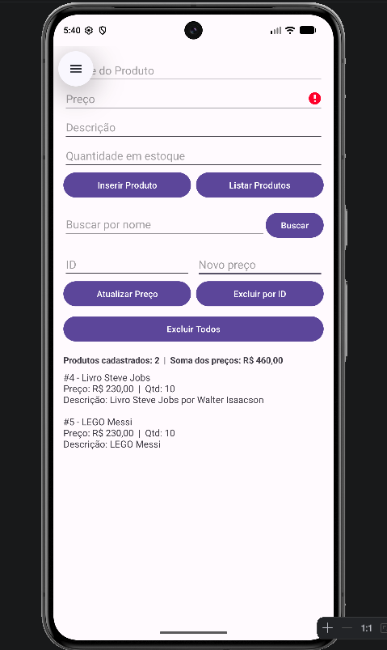

# AppRoomProduto — Cadastro e gerenciamento de produtos

**Aluno:** Nícolas James de Campos  
**RA:** 213804  
**Disciplina:** Programação para Dispositivos Móveis  
**Professor:** Alessandro Ferreira Paz Lima

## Apresentação

O AppRoomProduto é um aplicativo Android desenvolvido em Kotlin para registrar e administrar produtos. A aplicação permite inserir novos itens, consultar os registros, pesquisar pelo nome, alterar o preço e excluir produtos individualmente ou remover todos os cadastros.

Os dados são armazenados localmente com Room, uma biblioteca que facilita o uso do SQLite no Android. Assim, os registros permanecem disponíveis quando o aplicativo é fechado e aberto novamente, desde que os dados do aplicativo não sejam apagados.

## Tecnologias utilizadas

- Kotlin
- Room 2.8.4 e SQLite
- ViewBinding
- Corrotinas Kotlin e `lifecycleScope`
- Android Studio e Gradle Kotlin DSL

## Organização do código

```text
app/src/main/java/br/unisanta/myapplication/
├── model/Product.kt       # Define os dados de cada produto
├── dao/ProductDao.kt      # Declara as operações de acesso ao banco
├── db/AppDatabase.kt      # Configura o banco Room
└── view/MainActivity.kt   # Gerencia a tela principal e as ações do usuário
```

## Capturas de tela





---

# Parte A — Implementações práticas

## A1. Limpeza dos campos depois do cadastro

Após salvar um produto com sucesso, os campos de entrada são esvaziados para que o usuário possa começar outro cadastro sem precisar apagar as informações manualmente. Ao final, o foco volta para o campo do nome, tornando o processo mais rápido.

A limpeza é chamada depois da inserção bem-sucedida, e não antes da tentativa de salvar os dados.

```kotlin
private fun limparCampos() {
    binding.editProductName.text.clear()
    binding.editProductPrice.text.clear()
    binding.editProductDescription.text.clear()
    binding.editProductQuantity.text.clear()
    binding.editProductName.requestFocus()
}
```


## A2. Verificação do preço informado

Antes de cadastrar o produto, o aplicativo tenta converter o texto do preço para um número. Caso o campo esteja vazio, não possa ser convertido ou contenha um valor menor ou igual a zero, a operação é interrompida e o usuário recebe uma indicação de erro no campo.

```kotlin
val price = priceText.toDoubleOrNull()

if (price == null || price <= 0.0) {
    binding.editProductPrice.error = "Informe um preço válido"
    binding.editProductPrice.requestFocus()
    return
}
```



## A3. Exibição dos produtos na interface

A listagem não fica restrita ao Logcat: os registros também são apresentados na tela, em um `TextView` chamado `txtListaProdutos`. Para cada produto, são mostrados o identificador, o nome, o preço, a quantidade e a descrição. Quando a descrição não foi preenchida, é exibido um traço no lugar dela.

```kotlin
binding.txtListaProdutos.text = products.joinToString("\n\n") {
    "#${it.id} - ${it.name}\n" +
        "Preço: ${formatarReais(it.price)}  |  Qtd: ${it.quantity}\n" +
        "Descrição: ${it.description.orEmpty().ifEmpty { "-" }}"
}
```

## A4. Resumo dos registros

Foi incluído um resumo com a quantidade de produtos retornados pela consulta e a soma dos preços unitários desses registros. A contagem é obtida com `products.size`, enquanto `sumOf` calcula a soma dos valores.

É importante observar que esse cálculo não representa o valor total do estoque, pois não multiplica o preço pela quantidade de unidades.

```kotlin
val total = products.sumOf { it.price }

binding.txtResumo.text =
    "Produtos cadastrados: ${products.size}  |  Soma dos preços: ${formatarReais(total)}"
```


## A5. Pesquisa pelo nome

A aplicação permite localizar produtos digitando o nome completo ou apenas uma parte dele. O DAO utiliza uma consulta SQL com `LIKE`, e os caracteres `%` antes e depois do texto permitem encontrar correspondências em qualquer posição do nome.

```kotlin
// ProductDao.kt
@Query("SELECT * FROM product WHERE name LIKE :nome")
suspend fun buscarPorNome(nome: String): List<Product>

// MainActivity.kt
val resultado = productDao.buscarPorNome("%$texto%")
mostrarNaTela(resultado)
```



## A6. Exclusão de registros

Foram implementadas duas formas de remoção. A primeira apaga todos os produtos cadastrados. A segunda procura um item pelo ID e o exclui somente quando o registro é encontrado.

```kotlin
// ProductDao.kt
@Query("DELETE FROM product")
suspend fun deleteAll()

@Delete
suspend fun delete(product: Product)

@Query("SELECT * FROM product WHERE id = :id")
suspend fun getById(id: Int): Product?
```

Na exclusão individual, a consulta retorna um produto ou `null`. Dessa maneira, a remoção só é executada se o identificador corresponder a um registro existente.


## A7. Atualização do preço

A funcionalidade de atualização recebe o ID do produto e o novo preço. Depois de localizar o registro, o aplicativo cria uma cópia do objeto com o preço alterado e envia essa versão ao Room por meio do método anotado com `@Update`. Os outros campos permanecem iguais.

```kotlin
// ProductDao.kt
@Update
suspend fun update(product: Product)

// MainActivity.kt
val product = productDao.getById(id)

if (product != null) {
    productDao.update(product.copy(price = novoPreco))
}
```



## A8. Inclusão do campo de quantidade

O modelo `Product` recebeu o atributo `quantity`, do tipo `Int`, para representar a quantidade de unidades de cada produto. O campo também foi acrescentado à interface, e a versão do banco foi alterada de 1 para 2.

```kotlin
@Entity
data class Product(
    @PrimaryKey(autoGenerate = true) val id: Int = 0,
    @ColumnInfo(name = "name") val name: String,
    @ColumnInfo(name = "price") val price: Double,
    @ColumnInfo(name = "description") val description: String?,
    @ColumnInfo(name = "quantity") val quantity: Int = 0
)
```

**O que ocorreu com os dados antigos?**

Os registros anteriores foram perdidos porque a estrutura do banco foi modificada sem uma migração entre as versões 1 e 2. Como a configuração utiliza `fallbackToDestructiveMigration()`, o Room recriou o banco para corresponder ao novo modelo.

Essa alternativa pode ser prática durante experimentos, mas não é adequada quando é necessário preservar dados de usuários. Uma migração poderia adicionar a nova coluna e definir zero como valor inicial para os produtos existentes:

```sql
ALTER TABLE product
ADD COLUMN quantity INTEGER NOT NULL DEFAULT 0;
```



---

# Parte B — Questões dissertativas

## B1. O que significa persistência de dados? O que aconteceria se os produtos fossem armazenados somente em uma `MutableList` na `MainActivity`?

Persistir dados significa guardá-los de forma que possam ser recuperados posteriormente, inclusive depois que o aplicativo é encerrado. Neste projeto, o Room grava os produtos em um banco SQLite local, permitindo consultar os registros em outras execuções do aplicativo.

Se os produtos estivessem somente em uma `MutableList` mantida na memória da `MainActivity`, eles existiriam apenas enquanto aquela estrutura permanecesse disponível. Ao encerrar o processo, os dados da lista seriam perdidos. A recriação da Activity também exigiria cuidado para não perder o estado mantido apenas nela.

Por isso, a lista em memória pode ser útil para manipular dados temporários, mas não substitui um mecanismo de armazenamento persistente quando os registros precisam continuar disponíveis.

## B2. Qual é a diferença entre usar SQLite diretamente e usar Room? Cite duas vantagens do Room.

SQLite é o mecanismo de banco de dados relacional usado para armazenar as informações no dispositivo. Room é uma biblioteca que oferece uma camada de abstração sobre o SQLite e integra o banco ao código Kotlin do aplicativo.

Ao trabalhar diretamente com SQLite, o desenvolvedor precisa cuidar de mais detalhes, como executar comandos SQL, gerenciar cursores e transformar os resultados em objetos. Com Room, as entidades e os métodos do DAO organizam boa parte desse trabalho.

Duas vantagens são:

1. **Menos código repetitivo:** anotações como `@Insert`, `@Update` e `@Delete` descrevem operações comuns sem exigir que cada uma seja implementada manualmente.
2. **Verificação das consultas:** as consultas SQL declaradas no DAO são analisadas durante a compilação, o que ajuda a detectar alguns erros antes de executar o aplicativo.

O Room também se integra às corrotinas Kotlin, facilitando a execução assíncrona das operações de banco.

## B3. Qual é a função de Entity, DAO e Database? Como essas partes se conectam neste aplicativo?

A **Entity** descreve a estrutura de uma tabela. Aqui, `Product` representa os produtos e define campos como ID, nome, preço, descrição e quantidade.

O **DAO** reúne as operações usadas para acessar e modificar os registros. A interface `ProductDao` contém consultas e métodos para cadastrar, listar, localizar, atualizar e excluir produtos.

A classe **Database**, representada por `AppDatabase`, informa ao Room quais entidades compõem o banco, define sua versão e disponibiliza acesso ao DAO.

Na prática, a `MainActivity` solicita operações ao `ProductDao`; o Room executa essas operações no banco configurado por `AppDatabase`, usando `Product` como modelo dos registros. Essa divisão deixa as responsabilidades mais claras do que concentrar todas as consultas na tela.

## B4. Por que evitar operações de banco na thread principal? O que é ANR e como `suspend` e `lifecycleScope.launch` ajudam?

A thread principal é responsável por desenhar a interface e responder às interações. Se ela ficar ocupada esperando uma operação demorada, a tela pode congelar e deixar de responder. Se essa situação persistir, o Android pode apresentar um aviso de ANR, sigla de *Application Not Responding*.

No projeto, os métodos do DAO são declarados com `suspend`, e as ações da interface iniciam corrotinas por meio de `lifecycleScope.launch`. O Room oferece suporte para executar essas operações suspensas sem bloquear a thread principal enquanto o banco responde.

O `lifecycleScope` também associa a corrotina ao ciclo de vida da Activity, cancelando-a quando a Activity é destruída. Isso ajuda a evitar trabalho ligado a uma tela que já não existe. Portanto, `suspend` e `launch` fazem parte da solução assíncrona, enquanto o Room fornece o comportamento apropriado para as operações do banco.

## B5. O que faz `fallbackToDestructiveMigration()`? Por que pode ser perigoso e qual é a finalidade de uma `Migration`?

`fallbackToDestructiveMigration()` permite que o Room recrie as tabelas quando a versão do banco muda e não há uma migração disponível para o caminho necessário. Como recriar a estrutura pode exigir apagar as tabelas antigas, os dados armazenados podem ser perdidos.

Isso ocorreu ao adicionar o campo `quantity`: o banco passou da versão 1 para a 2, mas não foi definida uma migração para adaptar a tabela existente. A configuração destrutiva permitiu criar o banco novamente, porém os produtos que já estavam salvos desapareceram.

Uma `Migration` descreve as alterações necessárias para transformar o esquema antigo no novo e preservar os registros sempre que possível. Para esse caso, a migração poderia adicionar a coluna com um valor padrão:

```kotlin
val MIGRATION_1_2 = object : Migration(1, 2) {
    override fun migrate(db: SupportSQLiteDatabase) {
        db.execSQL(
            "ALTER TABLE product ADD COLUMN quantity INTEGER NOT NULL DEFAULT 0"
        )
    }
}
```

Depois, seria necessário registrar a migração na configuração do Room com `addMigrations(MIGRATION_1_2)` e testar a atualização a partir de um banco da versão anterior.

## B6. Qual é a vantagem do ViewBinding sobre `findViewById()`? Que erros ele ajuda a evitar?

Com `findViewById()`, cada componente precisa ser localizado pelo seu identificador no layout, e o código fica mais repetitivo. O ViewBinding gera uma classe de ligação para o layout, permitindo acessar os componentes por propriedades como `binding.editProductName`.

Isso torna o acesso mais direto e oferece verificação de tipos durante a compilação. Assim, reduz a necessidade de conversões manuais e ajuda a identificar referências incompatíveis ou componentes que não existem no layout associado. Também deixa o código da Activity mais legível.

## B7. Por que um aplicativo maior pode usar Singleton para o banco? O que pode acontecer se cada tela criar sua própria instância?

Um Singleton é uma forma de compartilhar uma única instância de um objeto dentro do processo do aplicativo. Em um sistema com diversas telas, disponibilizar uma instância compartilhada de `AppDatabase` evita construir repetidamente o objeto de acesso ao banco e centraliza sua configuração.

Se cada tela criar sua própria instância, haverá inicializações desnecessárias e mais complexidade para manter a configuração consistente. Isso não significa, por si só, que os dados locais serão bancos independentes: as instâncias ainda podem apontar para o mesmo arquivo SQLite. O problema principal é a duplicação de recursos e a manutenção mais difícil.

Como o aplicativo atual é pequeno, a criação do banco na Activity atende à estrutura existente. Em uma evolução com várias telas, seria melhor centralizar a instância em um ponto compartilhado, por exemplo, na classe `Application` ou em um provedor de dependências.

## B8. Quais dificuldades apareceram durante o desenvolvimento e em qual aplicativo real o Room poderia ser útil?

Uma das partes que exigiu mais atenção foi compreender por que as operações com o banco precisam ser assíncronas. Estudar o uso de funções `suspend` e de corrotinas ajudou a entender como evitar que consultas e gravações deixem a interface sem resposta.

Outra situação importante foi acrescentar `quantity` ao modelo. A mudança da versão do banco sem uma migração adequada levou à recriação da base e à perda dos registros antigos. Isso mostrou que, além de alterar a entidade, é necessário pensar em como os dados existentes serão adaptados quando o esquema evoluir.

Um exemplo de aplicação real seria um sistema simples de estoque para uma papelaria. O usuário poderia cadastrar mercadorias, consultar preços e quantidades e atualizar os registros conforme os produtos fossem recebidos ou vendidos. O Room manteria os dados localmente, de modo que as consultas básicas funcionassem sem internet. Em uma versão mais completa, também seria possível incluir histórico de movimentações e alertas para produtos com poucas unidades.

---

## Como abrir o projeto

1. Baixe ou clone o repositório.
2. Abra a pasta do projeto no Android Studio.
3. Aguarde a sincronização do Gradle.
4. Inicie um emulador compatível ou conecte um dispositivo Android e execute o aplicativo.
